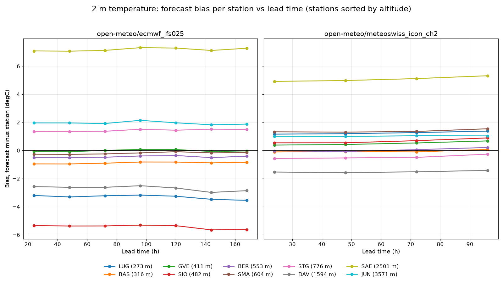
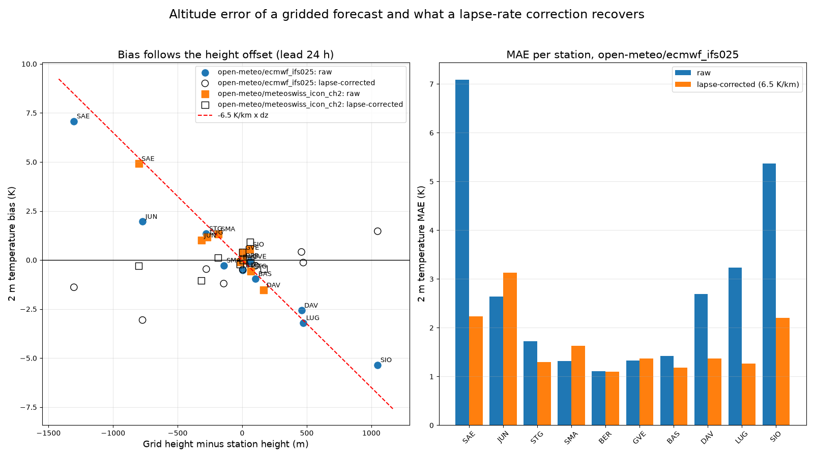

# forecast-vs-station-drift

**How far does a point forecast drift from what a Swiss weather station actually measured, per station, lead time and variable?**
Over Aug-Oct 2026 at ten Swiss weather stations, the ICON-CH2 2 m temperature forecast was off by 1.7 K on average one day ahead (2.1 K at four days), and ECMWF IFS by 2.8 K, mostly because its 25 km grid cell sits at the wrong height; a plain 6.5 K/km lapse-rate correction cut that to 1.7 K.



> This is an engineering exercise on public data, not an evaluation of any product. No affiliation with the data providers is claimed.

## Real results

Run with `python -m fvsd fetch --start 2026-08-01 --end 2026-10-31` on 2026-11-08, then `score` and `report`.

- **Period:** 2026-08-01 to 2026-10-31 (UTC, 92 days, hourly). 703,791 forecast/observation pairs.
- **Stations (10):** Zuerich/Fluntern SMA, Bern/Zollikofen BER, Basel/Binningen BAS, Geneve/Cointrin GVE, Sion SIO, Lugano LUG, St. Gallen STG, Davos DAV, Saentis SAE, Jungfraujoch JUN (273 m to 3571 m).
- **Observations:** MeteoSwiss SwissMetNet hourly values, `tre200h0` (2 m temperature), `rre150h0` (precipitation), `fkl010h0` (wind speed).
- **Forecasts:** Open-Meteo Previous Runs API, models `meteoswiss_icon_ch2` (2 km, lead 24-96 h) and `ecmwf_ifs025` (25 km, lead 24-168 h). No key, no account.
- **error = forecast - observation**, so a positive bias means too warm.

### 2 m temperature, mean over stations (each station counts once)

| Provider | Lead (h) | Stations | Bias (degC) | MAE (degC) | RMSE (degC) | MAE lapse-corr. | RMSE lapse-corr. |
|---|---:|---:|---:|---:|---:|---:|---:|
| ecmwf_ifs025 | 24 | 10 | -0.25 | 2.79 | 3.17 | 1.68 | 2.12 |
| ecmwf_ifs025 | 48 | 10 | -0.28 | 2.83 | 3.22 | 1.71 | 2.16 |
| ecmwf_ifs025 | 72 | 10 | -0.24 | 2.86 | 3.29 | 1.78 | 2.25 |
| ecmwf_ifs025 | 96 | 10 | -0.13 | 2.95 | 3.44 | 1.88 | 2.39 |
| meteoswiss_icon_ch2 | 24 | 9 | +0.66 | 1.70 | 2.04 | 1.16 | 1.52 |
| meteoswiss_icon_ch2 | 48 | 9 | +0.67 | 1.77 | 2.15 | 1.25 | 1.63 |
| meteoswiss_icon_ch2 | 72 | 9 | +0.74 | 1.90 | 2.34 | 1.40 | 1.83 |
| meteoswiss_icon_ch2 | 96 | 9 | +0.90 | 2.11 | 2.60 | 1.61 | 2.11 |

ICON-CH2 shows 9 stations because Open-Meteo reports a grid height of 0 m for the Lugano cell (a lake cell); that station has no lapse-corrected value and is left out of this table so raw and corrected columns average the same stations. Lead 120-168 h (IFS only) and precipitation/wind tables are in [`results/report.md`](results/report.md). IFS skill degrades from 2.79 K to 3.53 K MAE between 24 h and 168 h; wind is biased low (IFS -1.2 m/s, ICON-CH2 -0.4 m/s at 24 h), precipitation bias is near zero at 0.01-0.02 mm/h.

### Per station, 2 m temperature, lead 24 h

ICON-CH2 (grid cell vs station height in metres, bias and MAE in K):

| Station | Region | Alt (m) | Grid (m) | n | Bias | MAE | RMSE | Bias lapse-corr. | MAE lapse-corr. |
|---|---|---:|---:|---:|---:|---:|---:|---:|---:|
| LUG | Southern Alps | 273 | 0 | 2207 | +1.16 | 1.36 | 1.73 | - | - |
| BAS | Northern lowland | 316 | 299 | 2207 | -0.10 | 1.08 | 1.41 | -0.21 | 1.09 |
| GVE | Lake Geneva | 411 | 413 | 2207 | +0.38 | 1.03 | 1.38 | +0.40 | 1.04 |
| SIO | Rhone valley | 482 | 542 | 2207 | +0.54 | 1.55 | 2.08 | +0.93 | 1.67 |
| BER | Northern plateau | 553 | 558 | 2207 | -0.03 | 1.02 | 1.37 | +0.00 | 1.02 |
| SMA | Northern plateau | 604 | 418 | 2207 | +1.33 | 1.63 | 2.03 | +0.12 | 1.19 |
| STG | Northeast hills | 776 | 842 | 2207 | -0.57 | 1.14 | 1.49 | -0.14 | 1.00 |
| DAV | Alpine valley | 1594 | 1761 | 2207 | -1.53 | 1.71 | 2.06 | -0.45 | 1.13 |
| SAE | Prealpine summit | 2501 | 1700 | 2207 | +4.92 | 4.92 | 5.11 | -0.29 | 1.08 |
| JUN | High Alpine summit | 3571 | 3254 | 2207 | +1.01 | 1.22 | 1.47 | -1.05 | 1.24 |

ECMWF IFS 0.25 deg:

| Station | Region | Alt (m) | Grid (m) | n | Bias | MAE | RMSE | Bias lapse-corr. | MAE lapse-corr. |
|---|---|---:|---:|---:|---:|---:|---:|---:|---:|
| LUG | Southern Alps | 273 | 746 | 2207 | -3.20 | 3.23 | 3.58 | -0.13 | 1.27 |
| BAS | Northern lowland | 316 | 419 | 2207 | -0.96 | 1.42 | 1.76 | -0.29 | 1.19 |
| GVE | Lake Geneva | 411 | 470 | 2207 | -0.07 | 1.33 | 1.69 | +0.31 | 1.37 |
| SIO | Rhone valley | 482 | 1531 | 2207 | -5.35 | 5.37 | 5.87 | +1.47 | 2.20 |
| BER | Northern plateau | 553 | 557 | 2207 | -0.52 | 1.11 | 1.46 | -0.49 | 1.10 |
| SMA | Northern plateau | 604 | 461 | 2207 | -0.27 | 1.32 | 1.67 | -1.20 | 1.63 |
| STG | Northeast hills | 776 | 498 | 2207 | +1.35 | 1.72 | 2.07 | -0.46 | 1.30 |
| DAV | Alpine valley | 1594 | 2053 | 2207 | -2.57 | 2.69 | 3.09 | +0.41 | 1.37 |
| SAE | Prealpine summit | 2501 | 1198 | 2207 | +7.08 | 7.09 | 7.49 | -1.39 | 2.24 |
| JUN | High Alpine summit | 3571 | 2799 | 2207 | +1.96 | 2.64 | 3.07 | -3.06 | 3.13 |

### Altitude error and the lapse-rate correction

The station sits at z_station, the model grid cell at z_grid, so `T_station ~ T_grid + 6.5 K/km * (z_grid - z_station)`. Applied to 2 m temperature only (`--lapse-rate` changes the 6.5).



- Raw bias tracks the height offset: Saentis (IFS cell 1303 m below the station) is +7.1 K too warm, Sion (cell 1049 m above the valley floor) is -5.4 K too cold.
- At 24 h the correction lowers MAE at 7 of 10 stations for IFS and 5 of 9 for ICON-CH2. It makes things slightly worse at GVE, JUN, SMA (IFS) and BAS, GVE, JUN, SIO (ICON-CH2).
- Jungfraujoch is over-corrected (bias -3.1 K for IFS): a summit sits in free air and a 6.5 K/km valley-to-summit lapse rate is the wrong model there. Treat the correction as a first-order fix, not as downscaling.

## Quickstart

```bash
python -m venv .venv && . .venv/bin/activate      # Windows: .venv\Scripts\activate
pip install -e ".[dev]"
python -m pytest -q                               # offline, from committed fixtures
ruff check .

python -m fvsd fetch --start 2026-08-01 --end 2026-10-31   # downloads + caches into ./cache (about 45 s)
python -m fvsd score                                       # cache/*.parquet -> results/scores.parquet, meta.json
python -m fvsd report                                      # results/report.md, docs/figure*.png
```

Options: `fetch --stations SMA,DAV --models meteoswiss_icon_ch2 --variables t2m`, `score --lead-bin 24 --lapse-rate 6.5`.
Re-running `fetch` costs no requests for data already in `cache/`.

Outputs: `results/scores.parquet` (one row per provider x station x variable x lead: n, bias, MAE, RMSE, lapse-corrected versions, station and grid height), `results/meta.json`, `results/report.md`, `docs/figure.png` (1600x900), `docs/figure_altitude.png`.

## Architecture

```text
fvsd/
  stations.py       station list from the MeteoSwiss metadata CSV (name, lat/lon, height)
  observations.py   STAC file URLs, hourly CSV parser (UTC, end-of-interval)
  providers/
    base.py         ForecastProvider interface: fetch(station, start, end, variables, leads_h) -> DataFrame
    openmeteo.py    Open-Meteo Previous Runs adapter (free, no key)
  score.py          hour-mean alignment, lapse correction, bias/MAE/RMSE
  report.py         markdown tables and figures
  cli.py            fetch | score | report
```

Every provider returns the same long table (`provider, station, variable, valid_time, lead_h, forecast, grid_elevation_m`), so adding another one (any REST forecast API) means subclassing `ForecastProvider` and implementing one method, `fetch`.

## Data sources and attribution

- **Observations: Source: MeteoSwiss.** SwissMetNet automatic stations (ogd-smn), hourly files, on the federal open-data STAC at <https://data.geo.admin.ch/api/stac/v1/collections/ch.meteoschweiz.ogd-smn>, files at `https://data.geo.admin.ch/ch.meteoschweiz.ogd-smn/<abbr>/ogd-smn_<abbr>_h_recent.csv` (and `_historical_<decade>.csv`), station list `ogd-smn_meta_stations.csv`. License on the collection: CC-BY; MeteoSwiss requires the source to be cited ([terms](https://opendatadocs.meteoswiss.ch/general/terms-of-use), [documentation](https://opendatadocs.meteoswiss.ch/)). Timestamps are UTC and mark the end of the hour (the hourly value is the mean or sum of the last six 10-minute values). The repo does not redistribute the downloaded files; the test fixtures hold a 25-row excerpt and three station rows, both marked as MeteoSwiss data in `tests/fixtures/README.md`.
- **Forecasts:** [Open-Meteo Previous Runs API](https://open-meteo.com/en/docs/previous-runs-api) (CC BY 4.0; free tier for non-commercial use, see their terms before anything else). `<variable>_previous_day<N>` is the value predicted N x 24 h before the valid time, so lead times come in 24 h steps. Requests use `elevation=nan`, which switches off Open-Meteo's own height downscaling and returns the raw grid cell value and its height. The models behind it are MeteoSwiss ICON-CH2 and ECMWF IFS, served by Open-Meteo.

## Tests

63 pytest tests, all offline (`pytest -p no:asyncio` is set in `pyproject.toml`): known-answer metrics, hour-mean alignment, lapse correction, URL building and parsing for the Open-Meteo adapter, the provider interface, retry/cache behaviour, report/figure generation (including the 1600x900 size), and an end-to-end `fetch -> score -> report` run against committed fixtures with an injected HTTP layer. CI runs ruff and pytest on Python 3.11 and 3.12.

## What is not verified yet

- **Only one forecast provider is implemented.** The interface is generic, but only the free open-data adapter exists and has been run against the live service; there is no head-to-head comparison with other forecast APIs.
- **Short, single-season sample.** 92 days of late summer and autumn, one year. Not enough for winter inversions, snow, convective summers or any claim about a model in general. Confidence intervals are not computed; per-station values with n = 2207 are indicative, not significant.
- **Open-Meteo previous runs are a derived archive.** `previous_dayN` is Open-Meteo's own aligned archive of model runs, not the raw model output from MeteoSwiss or ECMWF. Lead times are multiples of 24 h, and I did not verify exact run initialisation hours. ECMWF IFS beyond about 90 h is served on a coarser time step and Open-Meteo interpolates to hourly, which matters most for precipitation.
- **Time alignment is an approximation.** MeteoSwiss values are hourly means ending at the timestamp; forecast temperature and wind are instants, so they are averaged over T-1 h and T. Precipitation is compared as is, assuming Open-Meteo's value is the sum of the preceding hour.
- **Grid height depends on Open-Meteo's report.** ICON-CH2 reports 0 m for Lugano's cell, treated here as missing (any grid height <= 0 is). Station height is the MeteoSwiss metadata height, the lapse rate is a fixed 6.5 K/km, not tuned and not season or time-of-day dependent.
- **Wind and precipitation** use point values at 10 m and at hourly sums; gauge undercatch, wind sensor height and station exposure are not handled. Jungfraujoch has no precipitation series, so precipitation tables cover nine stations.
- No quality control of observations beyond dropping empty values.

## Next steps

- A second provider adapter behind the same interface, for a head-to-head comparison.
- Longer window (a full year, winter included) and bootstrap confidence intervals.
- Diurnal-cycle view of the bias, and a season split.
- Per-station tuned lapse rate or a simple bias-correction baseline to compare against the 6.5 K/km rule.
- Probabilistic scores for precipitation (event hit rate, FSS) instead of hourly MAE.

## License

MIT, see `LICENSE`. Data keeps its own terms: MeteoSwiss open data (cite "Source: MeteoSwiss"), Open-Meteo (CC BY 4.0).
